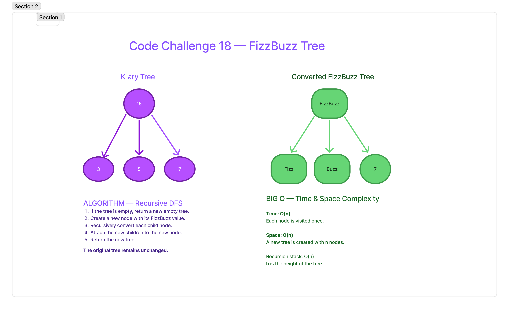

# FizzBuzz Tree

## Summary

This challenge uses recursion to create a new k-ary tree with FizzBuzz values while preserving the original tree structure.

## Description

Write a function called `fizzBuzzTree(tree)` that accepts a k-ary tree and returns a new k-ary tree.

For each node:
- If the value is divisible by both 3 and 5, replace it with `"FizzBuzz"`.
- If divisible by 3 only, replace it with `"Fizz"`.
- If divisible by 5 only, replace it with `"Buzz"`.
- Otherwise, convert the number to a string.

The original tree must remain unchanged.

## Whiteboard Process

## Approach & Efficiency

Use recursive depth-first traversal to visit every node.

1. Check whether the tree is empty.
2. Create a new node with the converted FizzBuzz value.
3. Recursively convert each child node.
4. Attach the converted children to the new node.
5. Return the new tree.

**Time Complexity: O(n)**

Every node is visited once.

**Space Complexity: O(n)**

A new tree is created containing all n nodes. The recursion also uses O(h) stack space, where h is the tree height.

## Solution

The implementation uses `Node`, `KaryTree`, and `fizzBuzzTree`.

Six Jest tests passed with 100% code coverage.

[FizzBuzz Tree Implementation](../tree-fizz-buzz/index.js)

[FizzBuzz Tree Tests](../tree-fizz-buzz/__tests__/tree-fizz-buzz.test.js)

